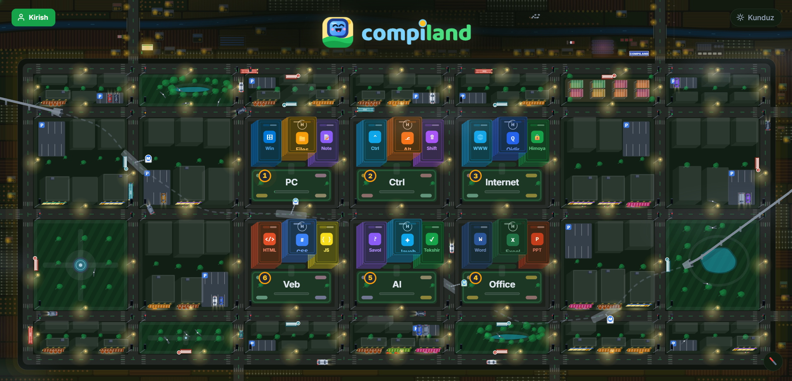
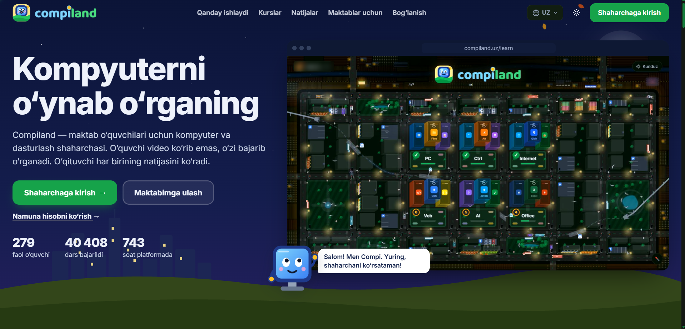

<a href="https://compiland.uz"></a>

<div align="center">

**I build software for the classroom I teach in.**

Informatics teacher at Rahimov School · Flutter & React developer · Software Development student at PDP University
<br/>
📍 Tashkent, Uzbekistan 🇺🇿

[Website](https://isfandiyormadaminov.dev) · [Telegram](https://t.me/isfandiyor_madaminov) · [YouTube](https://www.youtube.com/@isfandiyor_madaminov) · [Instagram](https://instagram.com/isfandiyor__madaminov)

</div>

<br/>

<div align="center">

| 👦 **279** | ✅ **40,408** | ⏱️ **743 h** | 🧑‍💻 **10** |
|:---:|:---:|:---:|:---:|
| active pupils on Compiland | lessons completed | spent learning on the platform | student projects in our first hackathon |

<sub>Compiland numbers as of November 2026</sub>

</div>

---

## Why I do this

I started teaching Frontend on YouTube while I was still in high school, because explaining code was how I learned it best.
Now I teach informatics to grades 5–9, and I keep running into the same problem: most learning tools weren't made for *our* kids, *our* classrooms, or *our* language.

So I build the tools myself. I write the code at night, my pupils test it the next morning, and I fix whatever confused them by the end of the week.
That loop of **teach, watch, build, repeat** is how everything below was made.

---

## 🏙️ Compiland: learn the computer by playing

<a href="https://compiland.uz">
  
</a>

**[compiland.uz](https://compiland.uz)** is a city where school kids learn computers and programming, in Uzbek.
Pupils don't watch videos; they **learn by doing**, district by district, guided by the mascot **Compi**. Teachers see every pupil's progress.

| # | District | What pupils learn |
|:-:|---|---|
| 1 | **PC** | Windows, files, notes: computer basics |
| 2 | **Ctrl** | Keyboard shortcuts and fluency |
| 3 | **Internet** | The web, search, staying safe online |
| 4 | **Office** | Word, Excel, PowerPoint |
| 5 | **AI** | Asking good questions and checking the answers |
| 6 | **Web** | HTML, CSS, JavaScript |

**My role:** I designed, built and maintain it on my own, and I've shipped improvements **daily since September 2026**, tested live in my own lessons.
**Next:** younger grades (1–4) and more schools.

<details>
<summary>📸 See the landing page</summary>
<br/>

</details>

[Website](https://compiland.uz) · [Telegram](https://t.me/compiland_uz) · [YouTube](https://www.youtube.com/@Compiland_uz) · [Instagram](https://instagram.com/compiland.uz) · 🔒 *source code is private*

---

## 🛠 Other work

| Project | What it is | Stack |
|---|---|---|
| **[rahimovdevs.tech](https://rahimovdevs.tech)** | Public portfolio of my students' projects, with a rating board and hackathon hall of fame | React · TypeScript · Supabase |
| **School Hackathon Program** | Quarterly hackathons for grades 5–9: teams build for 2–6 weeks, then demo to judges | Organizer & mentor |
| **Tree Data Structures** | 8 tree structures visualized in a clean-architecture Flutter app | Flutter · BLoC · GetIt |
| **TypeRacer** | Typing-speed game with a MonkeyType-style fade-as-you-type UI | React · TypeScript |

<!-- TODO: link each project name to its public repo (with screenshots in its README) -->

---

## 🧭 Journey

```
High school   Taught Frontend on YouTube
2023          Started Software Development at PDP University
2025          Biznex POS: installed and supported a POS system at real client businesses
2025          Invited to teach informatics at Rahimov School
2026          Launched rahimovdevs.tech and the school hackathon program
2026          Built and launched Compiland: 279 active pupils
```

---

## 🧰 Toolbox

<p>
  
</p>

I work AI-first with **Claude Code** to move fast, and I review and own every line that ships.

---

<div align="center">

**Open to:** ed-tech collaborations · schools interested in Compiland · freelance Flutter / React work

📫 The fastest way to reach me is [Telegram](https://t.me/isfandiyor_madaminov)

</div>
